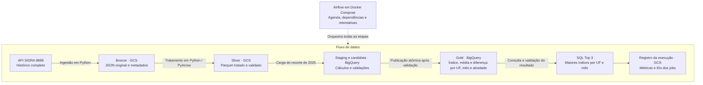

# Pipeline de indicadores da produção industrial

Este pipeline transforma os dados da Pesquisa Industrial Mensal — Produção Física (PIM-PF), publicados pelo IBGE na tabela SIDRA 8888, em uma base confiável para estudos sobre a atividade industrial brasileira. A coleta automatizada preserva todo o histórico disponível e considera atualizações mensais e revisões de períodos anteriores.

O resultado analítico reúne, para cada UF, mês de 2025 e atividade da Indústria de Transformação, o número-índice de produção física (base 2022 = 100), a média dos índices das atividades na mesma UF/mês e a diferença em relação a essa média. Uma consulta SQL identifica as três atividades com maiores índices em cada UF/mês. Os dados tratados e os resultados ficam disponíveis para análises estatísticas e de negócio, com rastreabilidade até a fonte original.

Python realiza a ingestão e o tratamento, o GCS armazena as camadas Bronze e Silver e o BigQuery disponibiliza a camada analítica Gold. O Airflow em Docker Compose orquestra o fluxo mensalmente.



A ligação pontilhada representa a orquestração; as setas contínuas representam o fluxo de processamento e seus resultados. Bronze e Silver preservam o histórico completo. A carga analítica no BigQuery usa o recorte de 2025 e só substitui a Gold depois de validar a candidata.

Validação realizada em 06/11/2026:

| Resultado | Quantidade |
| --- | --- |
| Histórico completo, 200201–202609 | 914.166 observações em 25 lotes |
| Gold de 2025 | 4.896 linhas, com 2.004 índices numéricos |
| Top 3 por UF/mês | 612 linhas |
| Airflow | Oito tarefas em sucesso nas execuções manual e agendada |
| Testes | 75 aprovados |

A Gold real coincidiu com a referência Decimal local. A repetição preservou os objetos GCS e os dados analíticos. O histórico Airflow permaneceu após reiniciar o PostgreSQL.

## Decisões técnicas

As escolhas priorizam processamento proporcional ao volume, dados rastreáveis e um ambiente reproduzível.

| Decisão | Necessidade atendida |
| --- | --- |
| Python, sem PySpark | O histórico medido tem 914 mil observações e é processado um lote anual por vez. Esse volume não exigiu processamento distribuído nem JVM. |
| PyArrow e Parquet | Preservar schema, datas e valores decimais e carregar os arquivos tratados diretamente no BigQuery. |
| Bronze e Silver no GCS | Separar resposta original de dados tratados, preservar a origem e permitir reprocessamento sem nova extração. |
| Gold no BigQuery | Entregar uma estrutura consultável via SQL e calcular médias e rankings com funções de janela, usando o ecossistema GCP adotado no projeto. |
| Airflow em Docker Compose | Disponibilizar dependências fixadas, orquestração, agenda, retentativas e acompanhamento por tarefa em um ambiente reproduzível. |
| LocalExecutor | Executar o pipeline no ambiente local sem acrescentar broker e workers distribuídos. |
| PostgreSQL | Persistir os metadados do Airflow: execuções, estados das tarefas e agenda. Os dados industriais permanecem no GCS/BigQuery. |
| Módulos por responsabilidade | Separar ingestão, tratamento, armazenamento e publicação para facilitar testes e manutenção. |
| Recarga histórica mensal | Capturar revisões do IBGE em meses antigos, além dos meses novos. A Gold mantém o recorte analítico de 2025. |
| Candidata validada antes da Gold | Conferir dados e cálculos antes de substituir atomicamente a tabela de consumo. |
| Auxiliares da execução atual e anterior | Permitir comparação e diagnóstico sem acumular tabelas no dataset. |
| Testes locais e evidências reais | Verificar regras sem credenciais e comprovar separadamente a integração com GCS, BigQuery e Airflow. |

## Executar localmente

Pré-requisitos: Python **3.12**, Git e internet para consultar o IBGE. Os testes usam fixtures e dispensam GCP.

```powershell
python -m venv .venv
.venv\Scripts\python.exe -m pip install -r requirements-dev.txt
.venv\Scripts\python.exe -m pip install --no-deps -e .
.venv\Scripts\python.exe -m pytest -q
```

Coleta e tratamento de todo o histórico, com resultado analítico local:

```powershell
.venv\Scripts\python.exe -m pim_pipeline.pipeline --run-id carga_completa
```

Os arquivos são gerados em `data/bronze`, `data/silver` e `data/analytics`. Para limitar a coleta a um período, acrescente `--start 202501 --end 202501` e use outro `run_id`. Para reutilizar uma Bronze existente, repita seu `--run-id` com `--from-bronze`.

## Executar com Airflow e GCP

Pré-requisitos adicionais: Docker Engine/Desktop com Compose, pelo menos 4 GB disponíveis ao Docker e os recursos/ADC descritos no [guia técnico](docs/guia_tecnico.md).

```powershell
.venv\Scripts\python.exe scripts/configure_local.py
```

Preencha `.env` com projeto, buckets, dataset, região e caminho externo do ADC. O script preserva uma configuração já existente. Depois:

```powershell
docker compose config --quiet
docker compose build
docker compose up airflow-init
docker compose up -d
docker compose exec airflow-scheduler airflow dags list-import-errors
docker compose exec airflow-scheduler airflow dags unpause pim_sidra_8888
docker compose exec airflow-scheduler airflow dags trigger pim_sidra_8888
```

Airflow: **http://localhost:8080**, usuário `admin`, senha em `runtime/airflow-passwords.json`. A DAG executa no dia **15 às 09h de Fortaleza**, com duas retentativas e uma execução ativa por vez. A máquina precisa permanecer ligada para cumprir a agenda.

A periodicidade é mensal. O dia 15 é uma escolha operacional parametrizável, sem sincronização automática com o calendário de divulgação do IBGE. `catchup=False` evita criar todas as execuções mensais antigas ao ativar a DAG. Uma execução manual permite atualizar os dados antes da próxima agenda.

Para acompanhar ou parar, preservando os metadados:

```powershell
docker compose logs -f airflow-scheduler
docker compose down
```

## Onde está cada parte

| Arquivo | Responsabilidade |
| --- | --- |
| `src/pim_pipeline/sidra.py` | HTTP, catálogo, divisão dos lotes e cobertura |
| `src/pim_pipeline/ingestion.py` | Resposta original e manifesto Bronze |
| `src/pim_pipeline/transform.py` | Tipos, marcadores, qualidade e Parquet Silver |
| `src/pim_pipeline/storage.py` | Gravação imutável local ou GCS |
| `src/pim_pipeline/loading.py` | Carga, descrições, validação e publicação BigQuery |
| `src/pim_pipeline/analytics.py` | Referência Decimal para conferir os cálculos |
| `src/pim_pipeline/pipeline.py` | Comando do pipeline e reprocessamento |
| `dags/pim_sidra.py` | Ordem das oito tarefas e agenda |
| `sql/` | Construção da Gold, validação e ranking |

O [guia técnico](docs/guia_tecnico.md) detalha regras, autenticação e reprocessamento.

## Execução por período e retomada

Uma execução local pode processar um intervalo específico e depois reutilizar os dados originais persistidos:

```powershell
.venv\Scripts\python.exe -m pim_pipeline.pipeline --run-id carga_janeiro_2025 --start 202501 --end 202501
.venv\Scripts\python.exe -m pim_pipeline.pipeline --run-id carga_janeiro_2025 --from-bronze
```

O primeiro comando consulta o IBGE e grava janeiro de 2025 em `data/`. O segundo reutiliza a Bronze, sem consultar a API, e refaz tratamento e análise. O JSON final informa contagens; `data/analytics/` contém Gold e Top 3 em JSON e Parquet. Para uma nova coleta da fonte, use outro `run_id`.

Esse recorte produz uma análise parcial local. A DAG padrão coleta o histórico completo e publica no BigQuery. Um reprocessamento parcial para publicação exige um baseline Silver completo: os meses solicitados são substituídos, os demais são preservados e a análise é recalculada. O [guia técnico](docs/guia_tecnico.md#repetição-revisões-e-falhas) contém o comando de backfill.

## Regras de processamento

### Escopo e cálculos

A Bronze preserva o JSON original e a Silver normaliza e valida o histórico em Parquet. A Gold seleciona UFs, meses de 2025, variável SIDRA 12606 e as 24 atividades de transformação da classificação 544, sem incluir agregados. O recorte analítico não descarta os demais períodos das camadas anteriores.

A média é aritmética simples dos índices numéricos na mesma UF/mês. Para índices 80, 100 e 120, a média é 100 e as diferenças são −20, 0 e 20. Essa média não corresponde ao agregado oficial ponderado do IBGE. Decimal/NUMERIC preserva precisão; a comparação com a referência local aceita tolerância de até uma unidade na nona casa decimal.

Valores sem índice numérico são representados como NULL, mantendo o texto original e o status de disponibilidade. Um zero explicitamente numérico continua sendo zero. A regra específica do traço está fundamentada no guia técnico. Valores NULL não entram na média nem no ranking.

O Top 3 usa `ROW_NUMBER` por UF/mês, com índice decrescente e código numérico da atividade crescente como desempate. Grupos com menos de três índices válidos retornam os disponíveis. Para executar `sql/top3_atividades.sql` no editor do BigQuery, substituir `{gold_table}` por `SEU_PROJETO.pim.pim_transformacao_2025`. No pipeline, a substituição é automática.

### Consistência e recuperação

A chave de negócio identifica cada observação. Objetos Bronze/Silver existentes só são reutilizados se o conteúdo coincidir. A publicação substitui a Gold após validar a candidata e registra um recibo por job, evitando acumular inserções a cada reexecução.

Antes da publicação, falhas preservam a Gold anterior. O Airflow aplica retentativas por tarefa. Falhas posteriores podem ser reconciliadas pelos dados e IDs dos jobs, pois GCS, BigQuery e Airflow não participam de uma transação única.

No BigQuery, `stg_` recebe os dados tratados de 2025 e `val_` guarda o resultado analítico para validação. A Gold é a tabela de consumo. Após publicar, são preservados somente os pares de auxiliares da execução atual e anterior; os sufixos identificam as coletas. As tabelas e colunas recebem descrições e labels de governança.

### Configuração e operação

O Simple Auth Manager do Airflow lê as senhas de um JSON em `runtime/`, com caminho definido no Compose. O `.env` configura os serviços e suas chaves internas. Ambos contêm segredos locais e ficam fora do Git e do ZIP. Credenciais GCP ficam fora do repositório e são montadas somente leitura.

Os testes funcionam sem cloud. A integração completa aceita projeto, buckets, dataset e credenciais próprios por configuração, sem depender de acesso ao ambiente original. O guia lista os recursos e as permissões necessárias.

O ambiente local depende da máquina e dos containers ligados. Uma operação contínua requer ambiente sempre disponível, identidade de serviço apropriada, alertas e retenção dos snapshots no GCS. A agenda deve acompanhar a periodicidade de divulgação da fonte.

## Evidências e entrega

As evidências desta versão pública têm nomes de projeto, buckets, contas de serviço e caminhos locais anonimizados. Valores analíticos, contagens, datas e IDs dos jobs foram preservados; os hashes registrados referem-se aos artefatos originais.

Em `docs/evidencias/`: `resumo.json` reúne execuções, jobs, saúde e idempotência; os manifestos identificam os lotes; `gold_2025.parquet` e `top3_2025.json` são exportações reais; `airflow.log` contém as oito tarefas; `testes.xml` registra os testes. A amostra usada pelos testes fica em `tests/fixtures/`.

Após registrar as mudanças em Git:

```powershell
.venv\Scripts\python.exe scripts/package_delivery.py
```

O ZIP em `dist/pim-industrial.zip` inclui fontes, documentação, evidências e histórico Git. O empacotador também inclui o documento complementar local, quando disponível, sem versioná-lo. Credenciais, `.env`, ambiente virtual e dados locais ficam fora da entrega.
